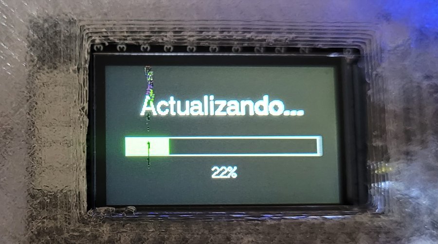

**English** | [Español](README.md)

# TTGO Macropad


A small macro keyboard with 6 Cherry MX keys and 2 rotary encoders, built on a
**TTGO T-Display** board (ESP32 + 1.14" ST7789 screen). Add the board's 2
built-in buttons and each encoder's push switch (if your encoders have one)
and you get up to 10 assignable buttons. It's configured from a desktop app in
Python (Linux/Wayland/KDE, plus Windows).

- When idle, the screen shows speedometer-style gauges for CPU% and GPU%
  (GPU via `nvidia-smi`), bars for RAM% and VRAM%, and CPU/GPU temperatures.
  Everything updates on its own.
- When you touch a button or encoder, it shows the active layer (a 3×2 grid
  with the 6 keys, plus a column for the 2 built-in buttons). After a few
  seconds of inactivity (configurable) it goes back to the stats screen.
- Any button in a layer can be "next / previous layer / go to layer N", so you
  can have several sets of shortcuts. Layers can also switch on by themselves
  depending on the program in the foreground (see
  [per-program layers](docs/actions.md#per-program-layers)).
- Keys are real keystrokes (volume, brightness, shortcuts, anything) sent
  through a kernel-level virtual keyboard (`evdev`/`uinput`), with no need
  for X11 or ydotool. Buttons can also run commands or scripts.
- The interface (Plasma widget, Windows app and the board's screen) follows
  your system language. English and Spanish are included; see
  [Language](#language).
- With the [browser extension](#browser-extension): per-site layers, YouTube
  covers, video and meeting controls, and any button on a page (like
  YouTube's Like) on a key.

> **Does your encoder have no push switch?** The EC11 is sold with a push
> switch (5 pins: 3 on one side, 2 on the other) and without one (3 pins
> only); cheap clones come both ways too. Without the switch everything else
> works the same: turning works normally, and buttons 9 and 10
> ("Encoder 1/2 (press)") simply don't exist. Leave them on "None" and don't
> wire GPIO15 or GPIO2. Left unconnected, those pins stay idle (internal
> pull-up), so they won't produce phantom presses.

See [docs/schematic.en.html](docs/schematic.en.html) (visual schematic) or
[docs/wiring.en.md](docs/wiring.en.md) for the pinout and the parts list.

The 3D-printable case (parametric OpenSCAD + ready-to-print STLs) is in
[gabinete/](gabinete/README.en.md).

## Photos

| Clock and weather | PC stats |
|---|---|
|  |  |
| **Inside** (case printed in clear filament, with the LiPo battery) | **Clock and weather screen** |
|  |  |

## Architecture

This ESP32 board has no native USB (confirmed with `esptool chip-id`: it's an
ESP32-D0WDQ6-V3 with a CH9102 serial bridge), so it can't be a USB HID
keyboard by itself. That's why the board is a "dumb" peripheral: it reads
buttons/encoders and draws the screen. All the logic (layers, mappings, what
to show) lives in the desktop app, which talks to it with a JSON-per-line
protocol over USB serial at 921600 baud. Protocol details are in the comments
of `firmware/src/protocol.cpp` and `desktop-app/macropad/serial_link.py`.

## Firmware (`firmware/`)

Built with PlatformIO (Arduino framework, board `esp32dev`), using
`TFT_eSPI` for the screen, `Bounce2` for the buttons and `ESP32Encoder` for
the encoders.

```bash
cd firmware
python3 -m venv .venv          # if it doesn't exist yet
.venv/bin/pip install platformio
.venv/bin/pio run                              # build
.venv/bin/pio run -t upload --upload-port /dev/ttyACM0   # flash
.venv/bin/pio device monitor -p /dev/ttyACM0 -b 921600    # watch logs/events
```

Ready-made firmware binaries are attached to each
[release](https://github.com/Yyymira/TTGO-Macropad/releases).

## Desktop app (`desktop-app/`)

Python + PySide6. It uses `psutil` (stats), `pyserial` (talking to the board)
and, to send keystrokes, `evdev`/`uinput` on Linux or the Win32 API on
Windows (`macropad/injector.py` picks the right backend from `sys.platform`;
see `macropad/injector_linux.py` / `injector_windows.py`).

### Linux

On Fedora, `psutil`/`evdev`/`PySide6` are available as system packages
(`python3-psutil`, `python3-evdev`, `python3-pyside6`), so the venv is created
with `--system-site-packages` and only `pyserial` is installed separately. On
other distros, install those three with your package manager or with `pip`.

```bash
cd desktop-app
python3 -m venv --system-site-packages .venv   # if it doesn't exist yet
.venv/bin/pip install -r requirements.txt
linux/install.sh
```

`install.sh` integrates everything into KDE Plasma 6, with no windows:

- **Background service** (`daemon.py`, systemd user service
  `ttgo-macropad`): starts automatically when you log in and handles the
  board. It exposes a local API on `127.0.0.1:47823`, protected with a token
  only your user can read (`$XDG_RUNTIME_DIR/ttgo-macropad/token`).
- **Plasma widget** (`plasmoid/`): an icon in the panel or system tray that
  expands to show the status, stats, layers and the button/encoder editor.
  To show it: right-click the panel → *Add or Manage Widgets* →
  "TTGO Macropad", or *Configure System Tray → Entries → TTGO Macropad →
  Always shown*.

Useful commands: `systemctl --user status|restart|stop ttgo-macropad`,
`journalctl --user -u ttgo-macropad`. Running `install.sh` again updates the
service and the widget. After updating the widget, restart Plasma to see the
new version: `systemctl --user restart plasma-plasmashell`.

`main.py` (the tabbed window, the same one used on Windows) still works, but
don't run it together with the service: both would fight over the serial
port.

### Windows

1. Install the **CH9102/CH343** driver from the manufacturer (WCH). It's the
   board's USB-serial bridge; without it, Windows won't show it as a COM port.
2. Install Python 3.11+ from python.org (tick "Add python.exe to PATH").
3. Create the venv and install the dependencies (there are no system
   packages to reuse here, so the separate `requirements-windows.txt` brings
   everything):

   ```powershell
   cd desktop-app
   python -m venv .venv
   .venv\Scripts\activate
   pip install -r requirements-windows.txt
   python main.py
   ```

Known limitations on Windows (they degrade gracefully and don't break the
app):

- **CPU temperature**: `psutil` doesn't expose hardware sensors on Windows,
  so `cpu_temp` is always reported as `0`. GPU% and GPU temperature work the
  same as on Linux, through `nvidia-smi.exe` (it comes with the NVIDIA
  driver).
- **Brightness** (encoders mapped to `brightnessup`/`brightnessdown`): it's
  controlled through WMI (`WmiMonitorBrightnessMethods`), which only exists on
  panels that support it (usually laptops). On a regular desktop monitor,
  that action does nothing.
- **Autostart**: there's no equivalent of a systemd user service. To start the
  app when you log in, put a shortcut to
  `desktop-app\.venv\Scripts\python.exe main.py` in the Windows Startup folder
  (`shell:startup`), or create a task in Task Scheduler.

The window has two tabs:

- **Status**: connection to the board, current mode (idle/layer) and a log of
  raw events (useful for debugging).
- **Settings**: the layer editor. For each layer you set the action of the 10
  buttons (6 keys, 2 built-in buttons and the 2 encoder push switches, if you
  have them) and of the 2 encoders, plus the idle timeout. "Save and apply"
  stores it in `~/.config/ttgo-macropad/config.json` and uses it right away,
  without restarting the app or the board.

Closing the window sends it to the system tray (it keeps running); to really
quit, use "Quit" in the tray icon's menu.

### Available button actions

Full guide with every key name, how to use KDE/Windows shortcuts, and
examples: [docs/actions.md](docs/actions.md).

- `None`
- `Key / shortcut`: a comma-separated list of keys (e.g. `ctrl,t` or
  `playpause`). Supported names: any evdev `KEY_*` (lowercase, without the
  prefix), plus the handy aliases defined in `macropad/injector_linux.py`
  (`ctrl`, `shift`, `alt`, `super`, `vol+`, `vol-`, `mute`, `play`, `next`,
  `prev`, `brightnessup`, `brightnessdown`, etc).
- `Run command`: a command or script, run with bash (cmd.exe on Windows).
- `Next layer` / `Previous layer` / `Go to layer N`

### Encoder actions

Each encoder has a list of keys for "clockwise" and another for
"counterclockwise" (same format as above), or a command for each direction.
Typical presets are `volumeup`/`volumedown` and
`brightnessup`/`brightnessdown`, but you can use anything (zoom, scrolling,
whatever).

## Clock and weather, Bluetooth and OTA

These are set up in the widget's **Device** section (2.4 GHz WiFi network,
password and city) and are stored on the board.

- **Idle screen**: with the PC connected you choose *Stats only*, *Clock and
  weather only* or *Both* (alternating; how long each screen lasts is set in
  the widget, 10 s by default). A button with the *Switch idle screen* action
  pins one or the other temporarily.
- **Media**: while something plays on the PC (Spotify, the browser, VLC…), a
  third screen joins the rotation with the cover, title, artist, album,
  progress and play/pause state. The PC reads what's playing through MPRIS
  (the same standard Plasma uses), shrinks the cover and sends it to the
  board. Text is shown without accents (the screen fonts are basic). Linux
  only for now; it doesn't appear without the PC (Bluetooth), because a
  Bluetooth keyboard can't receive what's playing on the phone. If the PC stops sending
  data for 5 s (turned off, service stopped, or the board on battery away
  from the PC), it always shows the clock and the weather. Weather comes from
  [Open-Meteo](https://open-meteo.com) (free, no API key): temperature,
  humidity and the forecast for today and the next 2 days, updated every
  15 min. The city field accepts "City" or "City, country" to tell apart
  places with the same name.
- **Bluetooth**: without the PC, the board works as a Bluetooth keyboard
  ("TTGO Macropad") with the same layers and keys; the service copies the
  mapping to it every time you save. You pair it once from your phone. Media
  and volume keys work; brightness doesn't exist over Bluetooth. On the layer
  screen, a light-blue "BT" means a phone is connected. With the PC
  connected, each layer can target the PC or the phone: in a phone layer,
  keys go out over Bluetooth even while the board is plugged in (see
  [docs/actions.md](docs/actions.md#layers-for-the-phone)).
- **OTA (update over WiFi)**: with the board on WiFi, `firmware/ota_upload.sh`
  builds and uploads the firmware with no cable. The OTA password is
  generated automatically and lives in `~/.config/ttgo-macropad/config.json`
  (permissions 600, together with the WiFi password). The USB cable still
  works as a fallback.

  

- **Battery**: without the PC, the clock/weather screen and the layer screen
  show the battery level (or "USB" when plugged in). At 15 % a low-battery
  warning appears; at 5 % it dims the screen and turns WiFi off to last a bit
  longer (the clock keeps running; the weather stops updating).

To see the clock while the PC is off, the board needs power: many PCs cut USB
power when they shut down, so you need a LiPo battery (the TTGO has a
connector and charger) or a phone charger.

## Browser extension

The `browser-extension/` folder is an extension for Brave, Chrome, Chromium
(and Firefox 128+) that connects the browser to the macropad. It also works
with Flatpak browsers, since it only uses the service's local connection.

- **Per-site layers**: in "Switch to this layer automatically with" you can
  put domains (`youtube.com`, `meet.google.com`). A domain includes its
  subdomains (`google.com` covers `meet.google.com`), and sites take
  priority over the browser program itself.
- **Better media info**: covers from YouTube, YouTube Music, Spotify web,
  SoundCloud, etc.; a clean title, the channel as the artist, and the exact
  position.
- **Meetings**: while you're in Google Meet (or Teams web, experimental), the
  board shows a microphone, green (open) or red and crossed out (muted), and
  there are actions to mute the mic or turn off the camera even when the tab
  isn't in front.
- **"Browser" action** for buttons and encoders: video speed (+, -, normal),
  forward/back 10 s, skip YouTube ads, tab volume, go to the playing tab,
  meeting mic and camera. It acts on the tab that's playing (or the meeting
  tab), even if you're on another one.

**Installing it** (Brave/Chrome/Chromium): open `brave://extensions` (or
`chrome://extensions`), turn on **Developer mode**, press **Load unpacked**
and pick the `browser-extension` folder. On Firefox: `about:debugging` →
**This Firefox** → **Load Temporary Add-on** and pick `manifest.json` (it
stays until Firefox restarts).

**Pairing it** (once): in the widget's Device section, press **Pair
browser**; then press **Pair** in the extension's icon (you have 2 minutes).
It stores a key only the extension and the service know: without it, no web
page can talk to the macropad. The extension sends nothing outside your PC.

## Language

The app, the service, the Plasma widget and the board's screen follow your
system language: the Plasma language for the widget, `LANG` for the service
on Linux, and the Windows display language for the Windows app. The board
gets the language from the service and remembers it, so in Bluetooth mode it
keeps using the last one. If your language isn't translated, everything shows
in English.

Adding a language means adding its texts in three places:

- `desktop-app/macropad/i18n.py` (app and service)
- `desktop-app/plasmoid/contents/ui/Translations.js` (widget)
- `firmware/src/i18n.cpp` (board screen; ASCII only, the screen fonts have no
  accents)

## Project status

- [x] Base firmware: button/encoder input, idle and layer screens, JSON
      protocol over serial.
- [x] App: serial connection with auto-reconnect, live stats, layer state
      machine with idle timeout, key injection through `evdev`, layer/mapping
      editor with persistence, tray icon.
- [x] 6 Cherry MX keys and 2 encoders wired ([docs/wiring.en.md](docs/wiring.en.md))
      and tested.
- [x] Linux: background service with autostart + Plasma widget.
- [x] Case printed and assembled, fine-tuned with test prints (see
      [Photos](#photos)).
- [x] WiFi and clock/weather working on a real network.
- [x] Update over WiFi (OTA) tested: `firmware/ota_upload.sh` uploads the
      firmware with no cable and the board comes back on its own.
- [x] "Run command" action and battery indicator.
- [x] Bluetooth keyboard tested with a phone.
- [x] Interface in English and Spanish, following the system language.
- [x] Per-program and per-site layers, PC/phone destination per layer.
- [x] Media screen with cover art (Spotify, the browser, etc.).
- [x] Browser extension: YouTube covers, per-site layers, video actions and
      "Click…" page buttons (tested with YouTube's Like).
- [x] Per-button alias and labels that always fit on the screen.
- [ ] Test the meeting indicator with a real Google Meet call (Teams web is
      experimental).
- [ ] Check the battery reading while running unplugged.
- [ ] Test the app on Windows.
