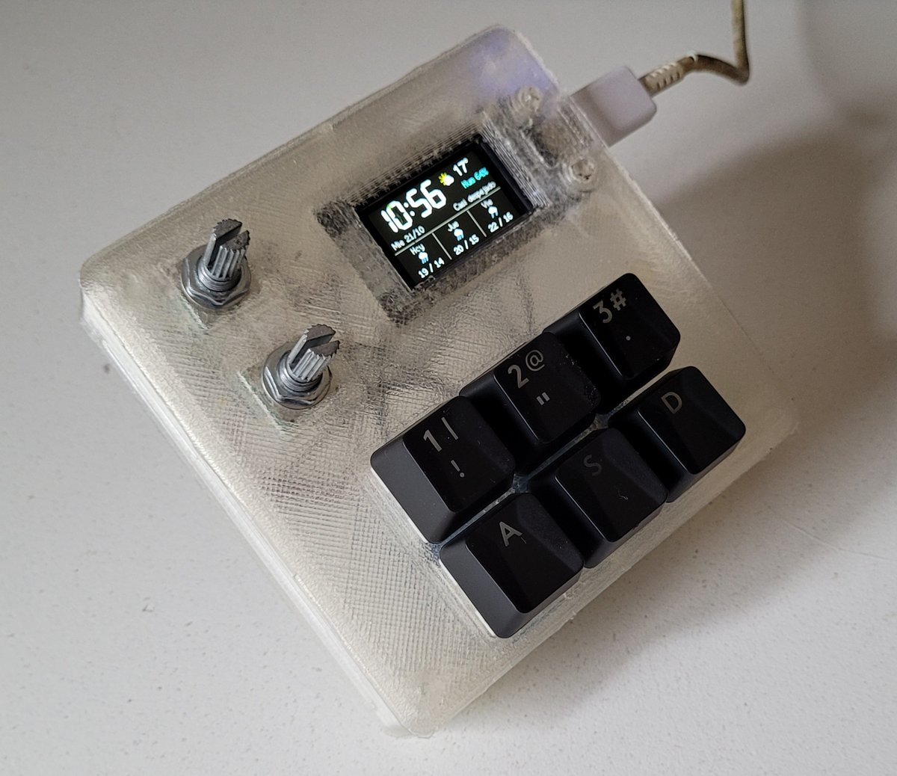
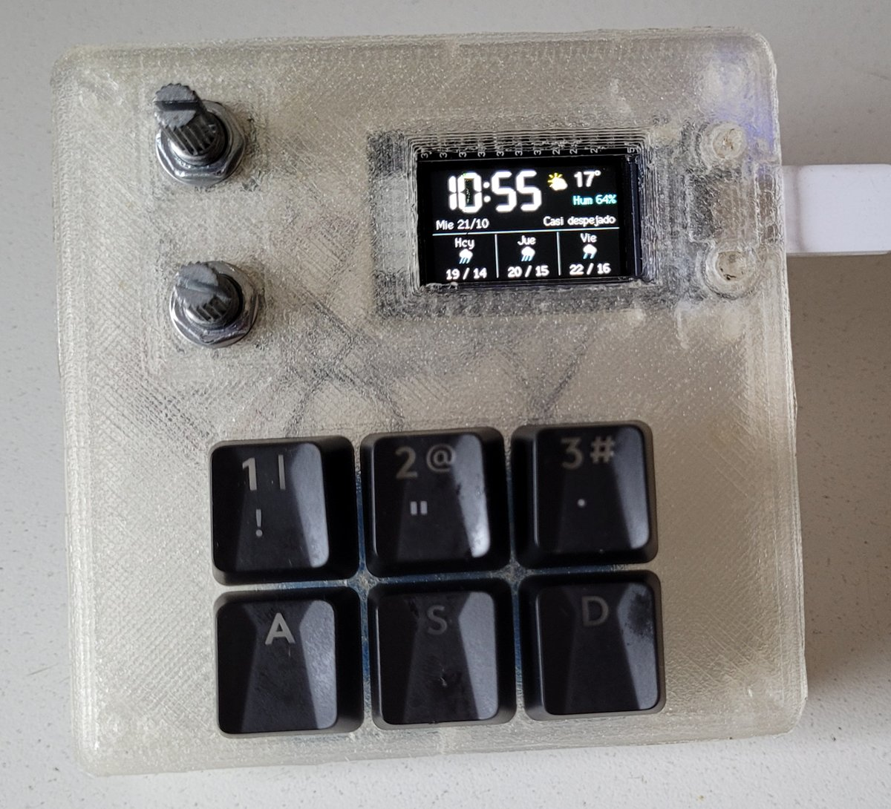
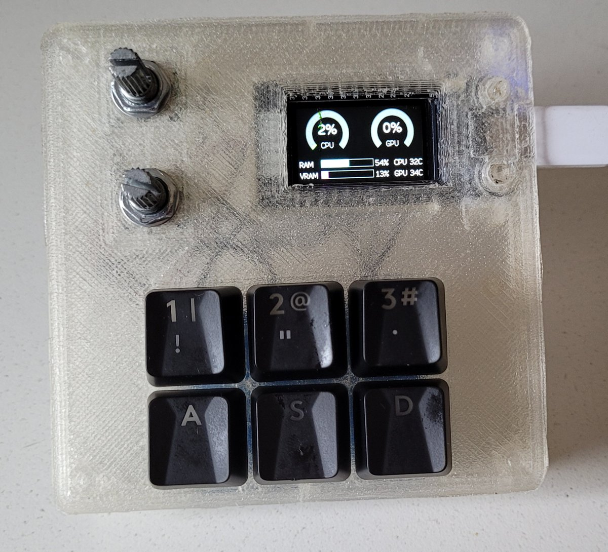
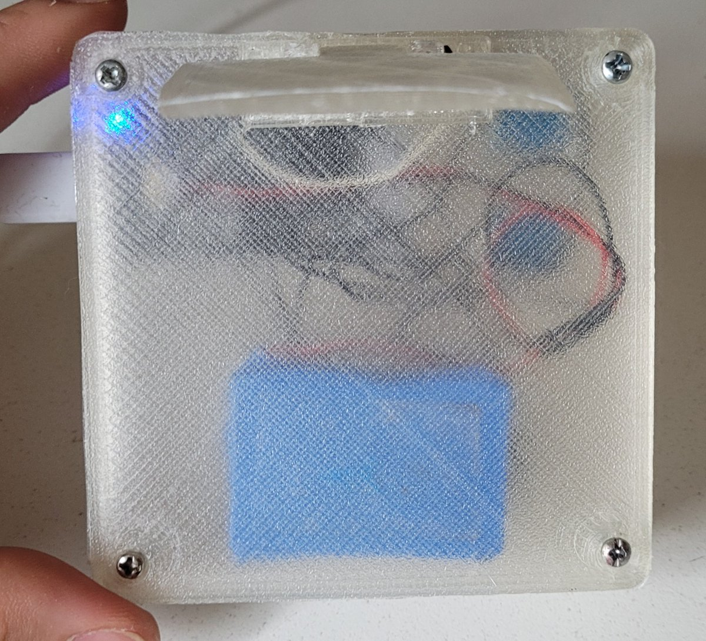
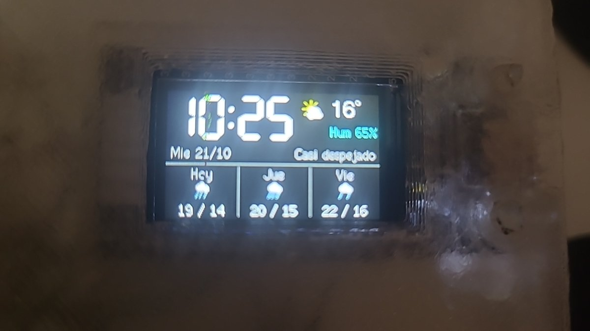

# TTGO Macropad



Mini teclado de macros con 6 teclas Cherry MX + 2 encoders rotativos sobre una placa
**TTGO T-Display** (ESP32 + pantalla ST7789 1.14") — más los 2 botones
integrados de la placa y el pulsador de cada encoder (si tus encoders lo traen), hasta 10 botones asignables —, programable desde una app
de escritorio en Python (Linux/Wayland/KDE).

- En reposo, la pantalla muestra gauges tipo velocímetro para CPU% y GPU%
  (GPU vía `nvidia-smi`), una barra para RAM% y números para las
  temperaturas de CPU y GPU — todo se actualiza solo, sin tocar nada.
- Al tocar un botón o encoder, pasa a mostrar la capa activa (grilla 3×2 con las
  6 teclas, más una columna con los 2 botones integrados). Tras unos segundos de inactividad (configurable), vuelve sola
  a la pantalla de stats.
- Un botón de cada capa puede estar mapeado a "capa siguiente/anterior/ir a
  capa N", permitiendo tener varios set de atajos.
- Los encoders inyectan teclas reales (volumen, brillo, o lo que el usuario
  quiera) vía un teclado virtual a nivel kernel (`evdev`/`uinput`), sin
  necesitar X11 ni ydotool.

> **¿Tu encoder no tiene pulsador?** El EC11 se vende con pulsador (5 pines:
> 3 de un lado y 2 del otro) y sin pulsador (solo 3 pines); los clones baratos
> también vienen de las dos formas. Sin pulsador funciona todo igual: el giro
> anda normal y los botones 9 y 10 ("Encoder 1/2 (apretar)") simplemente no
> existen — dejalos en "Ninguna" y no cables GPIO15 ni GPIO2. Sin nada
> conectado esos pines quedan en reposo (pull-up interno), así que no generan
> pulsaciones fantasma.

Ver [docs/schematic.html](docs/schematic.html) (esquemático visual) o
[docs/wiring.md](docs/wiring.md) para el pinout y la lista de compras —
**todavía falta cablear las 6 teclas Cherry MX + 2 encoders** (los 2 botones
integrados de la placa ya funcionan).

El gabinete imprimible en 3D (OpenSCAD paramétrico + STL listos) está en
[gabinete/](gabinete/README.md).

## Fotos

| Reloj y clima | Stats de la PC |
|---|---|
|  |  |
| **Por dentro** (gabinete impreso en filamento transparente, con la batería LiPo) | **Pantalla de reloj y clima** |
|  |  |

## Arquitectura

La placa ESP32 de este modelo no tiene USB nativo (confirmado con
`esptool chip-id`: es un ESP32-D0WDQ6-V3 con puente serie CH9102), así que no
puede ser un teclado HID por sí misma. Por eso la placa es un periférico
"tonto" — lee botones/encoders y dibuja la pantalla — y toda la lógica
(capas, mapeos, qué mostrar) vive en la app de escritorio, que le habla por
un protocolo JSON-por-línea sobre serial USB a 115200 baud. El detalle del
protocolo está en los comentarios de `firmware/src/protocol.cpp` y
`desktop-app/macropad/serial_link.py`.

## Firmware (`firmware/`)

Hecho con PlatformIO (Arduino framework, board `esp32dev`), usando
`TFT_eSPI` para la pantalla, `Bounce2` para los botones y `ESP32Encoder`
para los encoders.

```bash
cd firmware
python3 -m venv .venv          # si no existe todavía
.venv/bin/pip install platformio
.venv/bin/pio run                              # compilar
.venv/bin/pio run -t upload --upload-port /dev/ttyACM0   # flashear
.venv/bin/pio device monitor -p /dev/ttyACM0 -b 115200    # ver logs/eventos
```

## App de escritorio (`desktop-app/`)

Python + PySide6. Usa `psutil` (stats), `pyserial` (comunicación con la
placa) y, para inyectar teclas, `evdev`/`uinput` en Linux o la API Win32 en
Windows (`macropad/injector.py` elige el backend correcto según
`sys.platform`; ver `macropad/injector_linux.py` / `injector_windows.py`).

### Linux

En Fedora, `psutil`/`evdev`/`PySide6` ya vienen como paquetes de sistema
(`python3-psutil`, `python3-evdev`, `python3-pyside6`), por eso el venv se
crea con `--system-site-packages` y solo instala `pyserial` aparte.

```bash
cd desktop-app
python3 -m venv --system-site-packages .venv   # si no existe todavía
.venv/bin/pip install -r requirements.txt
linux/install.sh
```

`install.sh` deja todo integrado a KDE Plasma 6, sin ventanas:

- **Servicio de fondo** (`daemon.py`, servicio systemd de usuario
  `ttgo-macropad`): arranca solo al iniciar sesión y maneja la placa. Expone
  una API local en `127.0.0.1:47823` protegida con un token que solo tu
  usuario puede leer (`$XDG_RUNTIME_DIR/ttgo-macropad/token`).
- **Widget de Plasma** (`plasmoid/`): ícono en el panel o en la bandeja que
  despliega el estado, las stats, las capas y el editor de botones/encoders.
  Para mostrarlo: clic derecho en el panel → *Agregar o administrar
  widgets* → "TTGO Macropad", o *Configurar bandeja del sistema → Entradas →
  TTGO Macropad → Mostrar siempre*.

Comandos útiles: `systemctl --user status|restart|stop ttgo-macropad`,
`journalctl --user -u ttgo-macropad`. Volver a correr `install.sh` actualiza
el servicio y el widget.

`main.py` (la ventana con pestañas, la misma que se usa en Windows) sigue
funcionando, pero no hay que correrla junto con el servicio: los dos
pelearían por el puerto serie.

### Windows

1. Instalar el driver **CH9102/CH343** del fabricante (WCH) — es el puente
   USB-serie de la placa; sin él, Windows no la muestra como puerto COM.
2. Instalar Python 3.11+ desde python.org (tildar "Add python.exe to PATH").
3. Crear el venv e instalar dependencias (acá no hay paquetes de sistema
   que reusar, por eso el `requirements-windows.txt` separado trae todo):

   ```powershell
   cd desktop-app
   python -m venv .venv
   .venv\Scripts\activate
   pip install -r requirements-windows.txt
   python main.py
   ```

Limitaciones conocidas en Windows (se degradan solas, no rompen la app):

- **Temperatura de CPU**: `psutil` no expone sensores de hardware en
  Windows, así que `cpu_temp` siempre se reporta como `0`. GPU% y
  temperatura de GPU sí funcionan igual que en Linux, vía `nvidia-smi.exe`
  (viene con el driver de NVIDIA).
- **Brillo** (encoders mapeados a `brightnessup`/`brightnessdown`): se
  controla vía WMI (`WmiMonitorBrightnessMethods`), que solo existe en
  paneles que lo soportan (típicamente notebooks). En un monitor de
  escritorio normal, esa acción no hace nada.
- **Autostart**: no hay equivalente a un servicio de usuario systemd; para
  arrancar la app al iniciar sesión, poner un acceso directo a
  `desktop-app\.venv\Scripts\python.exe main.py` en la carpeta de Inicio de
  Windows (`shell:startup`), o crear una tarea en el Programador de tareas.

La ventana tiene dos pestañas:

- **Estado**: conexión con la placa, modo actual (idle/capa) y un log de
  eventos crudos (útil para debug).
- **Configuración**: editor de capas — por cada capa se define la acción de
  los 10 botones (6 teclas, 2 integrados y el pulsador de los 2 encoders, si los tienen) y de los 2 encoders, y el timeout de inactividad. "Guardar y
  aplicar" persiste en `~/.config/ttgo-macropad/config.json` y lo usa al
  toque, sin reiniciar la app ni la placa.

Cerrar la ventana la manda a la bandeja del sistema (sigue corriendo); para
salir de verdad, usar "Salir" del menú del ícono de bandeja.

### Acciones de botón disponibles

Guía completa con todos los nombres de teclas, cómo pasar atajos de KDE y
ejemplos: [docs/acciones.md](docs/acciones.md).


- `Ninguna`
- `Tecla / atajo`: lista de teclas separadas por coma (ej: `ctrl,t` o
  `playpause`). Nombres soportados: cualquier `KEY_*` de evdev (en
  minúscula, sin el prefijo), más los alias cómodos definidos en
  `macropad/injector.py` (`ctrl`, `shift`, `alt`, `super`, `vol+`, `vol-`,
  `mute`, `play`, `next`, `prev`, `brightnessup`, `brightnessdown`, etc).
- `Ejecutar comando`: un comando o script, con bash (en Windows, cmd.exe).
- `Capa siguiente` / `Capa anterior` / `Ir a capa N`

### Acciones de encoder

Cada encoder tiene una lista de teclas para "horario" y otra para
"antihorario" (mismo formato que arriba). Los presets típicos son
`volumeup`/`volumedown` y `brightnessup`/`brightnessdown`, pero se puede
poner cualquier cosa (zoom, scroll, lo que sea).

## Reloj y clima, Bluetooth y OTA

Se configuran desde la sección **Dispositivo** del widget (red WiFi de 2.4 GHz,
contraseña y ciudad) y quedan guardados en la placa.

- **Pantalla de reposo**: con la PC conectada se elige *Solo stats*, *Solo
  reloj y clima* o *Ambos* (alterna cada 10 s). Si la PC deja de mandar datos
  por 5 s (apagada, servicio detenido, o la placa a batería lejos de la PC),
  queda siempre el reloj con el clima. El clima viene de
  [Open-Meteo](https://open-meteo.com) (gratis, sin API key): temperatura,
  humedad y pronóstico de hoy y los 2 días siguientes, actualizado cada 15 min.
  La ciudad acepta "Ciudad" o "Ciudad, país" para desambiguar.
- **Bluetooth**: sin la PC, la placa funciona como teclado Bluetooth
  ("TTGO Macropad") con las mismas capas y teclas — el servicio le copia el
  mapeo cada vez que se guarda. Se empareja una vez desde el celular. Las
  teclas multimedia y de volumen funcionan; el brillo no existe en Bluetooth.
  En la pantalla de capa, "BT" en celeste indica que hay un celular conectado.
- **OTA (actualizar por WiFi)**: con la placa en el WiFi, `firmware/ota_upload.sh`
  compila y sube el firmware sin cable. La contraseña OTA se genera sola y vive
  en `~/.config/ttgo-macropad/config.json` (permisos 600, junto con la del WiFi).
  El cable USB sigue funcionando igual como respaldo.

- **Batería**: sin la PC, la pantalla de reloj/clima y la de capas muestran
  el nivel de la batería (o "USB" si está enchufada). Al llegar al 15 % aparece
  un aviso de batería baja; al 5 % baja el brillo y apaga el WiFi para durar
  un poco más (el reloj sigue andando, el clima deja de actualizarse).

Para ver el reloj con la PC apagada, la placa necesita energía: muchas PCs
cortan el USB al apagarse, así que hace falta una batería LiPo (la TTGO trae
conector y cargador) o un cargador de celular.

## Estado del proyecto

- [x] Firmware base: lectura de botones/encoders, display con pantalla idle
      y pantalla de capa, protocolo JSON sobre serial.
- [x] App: conexión serial con reconexión automática, stats en vivo,
      máquina de estados de capas con timeout de inactividad, inyección de
      teclas vía `evdev`, editor de capas/mapeos con persistencia, ícono de
      bandeja.
- [x] Probado de punta a punta con los 2 botones integrados de la placa
      (play/pause real sobre un video de YouTube, cambio de capa, vuelta
      automática a stats).
- [ ] Cablear las 6 teclas Cherry MX y los 2 encoders (ver
      [docs/wiring.md](docs/wiring.md)) y probar esa parte.
- [x] Linux: servicio de fondo con arranque automático + widget de Plasma.
- [x] Firmware: WiFi, reloj/clima, teclado Bluetooth en modo autónomo y OTA.
- [ ] Probar WiFi/clima/OTA con la red real y el Bluetooth con el celular.
