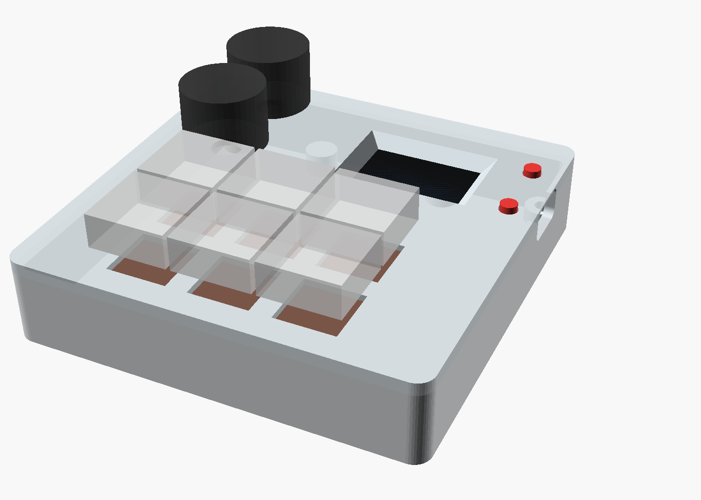

# Gabinete imprimible



Diseño paramétrico en OpenSCAD (`gabinete.scad`). Medida exterior:
**94.8 × 93.8 × 20.4 mm** (sin la pata ni las perillas/keycaps).

- 6 Cherry MX adelante en grilla 3 × 2, montados a presión en la tapa
  (agujero estándar 14 × 14 mm con 1.5 mm de "placa"). Los pines quedan al
  aire por abajo para soldar los cables directamente, sin PCB. Numeración
  (igual que en la app y la pantalla): fila de atrás 1-2-3, de adelante 4-5-6.
- 2 EC11 atrás a la izquierda; la tapa tiene 1.6 mm ahí para que entren
  arandela + tuerca en el buje M7.
- La TTGO entra a presión desde abajo en un marco con trabas, con el
  display contra la ventana. El USB-C sale por el costado derecho.
- 2 pulsadores sueltos que pasan por la tapa y apretan los botones
  integrados de la placa (GPIO0 y GPIO35): son los botones 7 y 8, también
  asignables desde la app (por defecto, capa anterior/siguiente).
- Pata trasera con bisagra dentada: se afloja el tornillo, se elige el
  ángulo (un "click" cada 15°) y se aprieta. Plegada da ~4° de
  inclinación; vertical, ~29°.

## Antes de imprimir todo: medir y probar

Las medidas de la TTGO son estimadas de las especificaciones, no de tu
placa. Con un calibre, verificá y corregí al principio de `gabinete.scad`:

| Parámetro | Qué medir |
|---|---|
| `pcb_l`, `pcb_w` | largo y ancho del PCB |
| `stack_top` | de la cara de arriba del PCB al vidrio del display |
| `btn_h` | de la cara de arriba del PCB al tope de los botones |
| `btn_dx`, `btn_dy` | posición de los botones respecto del centro del PCB |
| `disp_dx`, `disp_w`, `disp_h` | posición y tamaño del área visible |

Después imprimí las dos piezas de prueba (~15 min cada una):

- `prueba_ttgo.stl`: el sector de la tapa con el marco de la TTGO, la
  ventana y los pulsadores. Confirma que la placa traba, que el display
  queda centrado y que los pulsadores aprietan los botones.
- `prueba_mx_enc.stl`: un switch y un encoder. Confirma que el Cherry
  traba firme (si entra muy duro subí `mx_cut` a 14.1–14.2).

## Piezas (`stl/`, ya orientadas para imprimir)

| Archivo | Cant. | Notas |
|---|---|---|
| `tapa.stl` | 1 | Se imprime boca abajo (la cara visible queda contra la cama). |
| `base.stl` | 1 | Sin soportes. |
| `bisagra.stl` | 1 | Nudillos hacia arriba, sin soportes. |
| `pata.stl` | 1 | Acostada, sin soportes. |
| `pulsador.stl` | 1 (trae 2) | Parados; si el ala sale fea, usar borde (brim). |

PLA o PETG, capa 0.2 mm, 3 perímetros, 20 % de relleno.

## Tornillería

- 4 × M3×12 (tapa → base, se atornillan desde abajo en las torretas de la
  tapa; autorroscantes o métricos, el agujero es de 2.6 mm).
- 2 × M3×8 (bisagra → base).
- 1 × M3×25 + 1 tuerca M3 (eje de la bisagra; la tuerca va encastrada en
  el hexágono).
- 2 patitas de goma adhesivas de hasta 10 mm de diámetro (adelante).

## Armado

1. Colocar los 2 pulsadores en sus agujeros desde abajo de la tapa (el ala
   queda dentro del rebaje).
2. Encastrar la TTGO en el marco desde abajo, display hacia la ventana y
   USB-C hacia el costado derecho, hasta que las trabas hagan click.
3. Montar los 6 Cherry MX desde arriba y los 2 EC11 desde abajo
   (arandela + tuerca por arriba). Si tus EC11 tienen la pestañita
   antirrotación, doblala o cortala: la tapa no tiene ranura para ella.
4. Soldar los cables según [`docs/wiring.md`](../docs/wiring.md).
5. Cerrar con la base y los 4 M3×12.
6. Atornillar la bisagra debajo de la base, meter la pata entre los
   nudillos y pasar el M3×25 con la tuerca.

## Regenerar los STL

```bash
openscad -D 'pieza="tapa"' -o stl/tapa.stl gabinete.scad
# piezas: tapa, base, bisagra, pata, pulsador, prueba_ttgo, prueba_mx_enc
# "ensamble" (por defecto) muestra todo armado; angulo_pata lo rota
```
